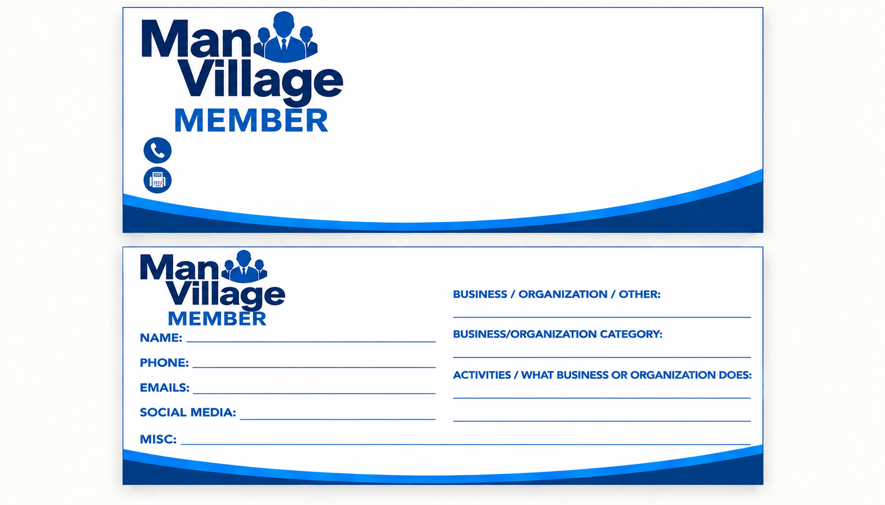

# Man Village Rolodex

A public catalogue of Man Village member business cards. Members fill out a form, the site renders their card in the Man Village Member design, and every card is filed A–Z by occupation.



## What it does

- **Home page:** every card, grouped A–Z by occupation (or by name), with an A–Z jump bar.
- **Search** across occupation, business name, description, town, and member name.
- **Filters:** one-tap occupation chips and a town / service area dropdown.
- **Form with live preview:** the back and front of the card fill in as you type.
- **Edit codes:** saving a new card gives the member a 10-character edit code. That code is the only way to change or delete the card, and the member's browser remembers it.
- **Admin mode:** the footer "Admin" link takes the `ADMIN_KEY` password. In admin mode you can add, edit, or delete any card without a code.
- **Spam protection:** a hidden honeypot field, plus a limit of 30 changes per 15 minutes per connection.

## Card fields

Name, Phone, Fax, Emails, Social media, Website, Business / organization / other, Occupation / category, Town / service area, What the business does, Misc.

Name and Occupation are required. Occupations are title-cased automatically so "barber" and "Barber" file together.

## Project layout

```
server.js            Express server + JSON API
src/store.js         Postgres storage (in-memory fallback for local dev)
public/index.html    The site
public/app.js        Rolodex, search, form, card rendering
public/styles.css    Card design + site styles
design/              Original card artwork
prototype/           First version built as a Claude artifact
railway.json         Railway deploy settings
```

## Deploy on Railway

1. In Railway: **New Project → Deploy from GitHub repo**, and pick this repo.
2. In the same project: **+ New → Database → PostgreSQL**.
3. Open the web service's **Variables** tab and add:
   - `DATABASE_URL` set to `${{Postgres.DATABASE_URL}}` (Railway's reference to the database you just added)
   - `ADMIN_KEY` set to a long password only you and Al know
4. Under **Settings → Networking**, click **Generate Domain** for a public URL, or add your own domain.

The `cards` table is created automatically on first start. Railway redeploys every time you push to `main`.

## Run locally

```bash
npm install
ADMIN_KEY=dev npm run dev        # in-memory data, gone on restart
# or point it at a real Postgres:
DATABASE_URL=postgresql://... ADMIN_KEY=dev npm start
```

Then open http://localhost:3000.

## API

| Method | Path | Notes |
| --- | --- | --- |
| GET | `/api/cards` | All cards (edit codes are never returned) |
| POST | `/api/cards` | Create; response includes `editCode` |
| PUT | `/api/cards/:id` | Header `X-Edit-Code` or `X-Admin-Key` |
| DELETE | `/api/cards/:id` | Header `X-Edit-Code` or `X-Admin-Key` |
| GET | `/healthz` | Health check for Railway |

Edit codes are stored as SHA-256 hashes, so nobody can read them back from the database. If a member loses their code, an admin can edit or delete the card for them.
